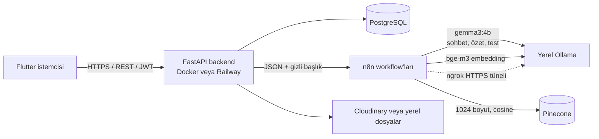

# Study Friend Backend

FastAPI tabanlı çalışma arkadaşı API'si. PostgreSQL veritabanı Alembic ile yönetilir; dosyalar Cloudinary'de saklanabilir. Yapay zekâ akışları n8n Cloud, yerel Ollama ve Pinecone ile entegre edilebilir.

## Dokümantasyon

- [Mimari ve akışlar](docs/architecture.md)
- [AI katmanı: Ollama, n8n ve Pinecone](docs/ai-layer.md)
- [API uçları ve kullanım örnekleri](docs/api.md)
- [Veritabanı şeması ve ER diyagramı](docs/database.md)
- [Ortam değişkenleri ve yapılandırma](docs/configuration.md)
- API'nin etkileşimli belgeleri: `/docs`; alternatif görünüm: `/redoc`; OpenAPI JSON: `/openapi.json`.

## Mimari



Sohbet, özet ve test üretimi n8n workflow'ları aracılığıyla yerel Ollama modelleriyle yapılır; ayrıntılar için [AI katmanına](docs/ai-layer.md) bakın.

## Docker ile çalıştırma

1. `.env.example` dosyasını `.env` olarak kopyalayın; yer tutucuları kendi servis ayarlarınızla doldurun. `POSTGRES_PASSWORD` zorunludur. `DATABASE_URL` Compose tarafından `db` servisine bağlanacak şekilde ayarlanır.
2. Proje kökünde çalıştırın:

   ```sh
   docker compose up --build
   ```

3. API belgeleri: <http://localhost:8000/docs>. Sağlık kontrolü: <http://localhost:8000/health>.

PostgreSQL verisi `postgres_data` adlı kalıcı Docker volume'ünde tutulur. Veritabanı portu host'a açılmaz; backend yalnızca `127.0.0.1:8000` üzerinden yayınlanır. Başlangıçta Alembic migration'ları uygulanır.

## İsteğe bağlı yerel Ollama

Ollama varsayılan `docker compose up` çalıştırmasında başlamaz. İsteğe bağlı başlatmak ve bir model indirmek için:

```sh
docker compose --profile ollama up -d ollama
docker compose exec ollama ollama pull gemma3:4b
docker compose exec ollama ollama pull bge-m3
```

Ollama host üzerinde yalnızca `127.0.0.1:11435` adresinden erişilebilir.

## Harici entegrasyonlar

- n8n Cloud'da `summarize-note`, `index-note`, `chat` ve `generate-quiz` webhook iş akışları kurulmalıdır.
- Pinecone index'i **1024 boyut** ve **cosine** metric ile oluşturulmalıdır.
- n8n Cloud'un yerel Ollama'ya erişmesi gerekiyorsa Ollama'nın `11435` portunu ngrok gibi bir tünel üzerinden erişilebilir yapıp ilgili iş akışında kullanın.
- Cloudinary, Google OAuth ve SMTP bilgileri `.env` içinde yapılandırılır. Bu dosyayı paylaşmayın veya imaja eklemeyin.
