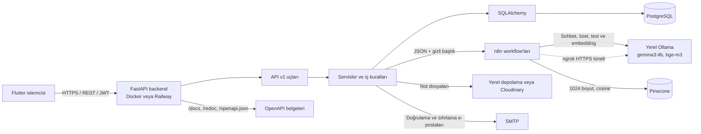
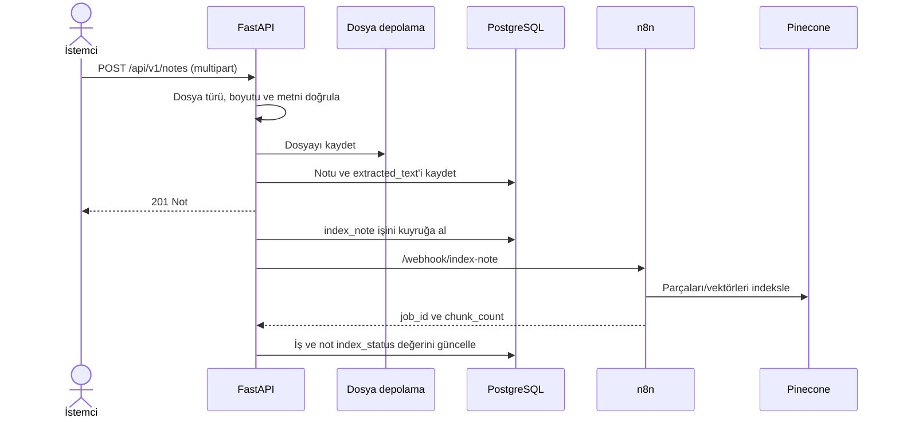
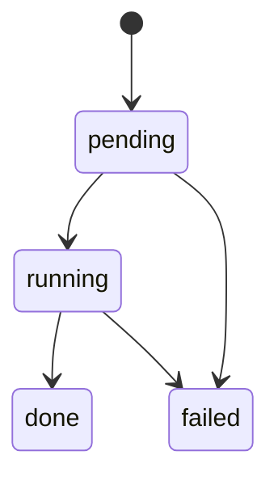

# Mimari ve iş akışları

## Genel bakış

Study Friend Backend; FastAPI üzerinde çalışan, SQLAlchemy 2.0 ile PostgreSQL'e erişen ve şema değişikliklerini Alembic ile yöneten bir REST API'dir. HTTP katmanı `app/api/v1/endpoints/` altında, doğrulama şemaları `app/schemas/`, ORM modelleri `app/models/`, iş kuralları ise `app/services/` altındadır.

İstemci yalnızca backend API'siyle konuşur. n8n ve vektör veritabanı entegrasyon ayrıntıları n8n workflow'larında bulunur; backend n8n webhook'larına HTTP isteği gönderir. Gerçek entegrasyon ayarlarını `.env` veya Railway değişkenlerinde tutun; dokümantasyona ya da Git'e eklemeyin.

Sohbet, özet ve test üretimi n8n workflow'ları aracılığıyla yerel Ollama modelleriyle yapılır; ayrıntılar için [AI katmanı](ai-layer.md).

## Katmanlar

| Katman | Konum | Sorumluluk |
|---|---|---|
| HTTP ve erişim kontrolü | `app/api/v1/endpoints/` | İstekleri alır, Bearer token üzerinden kullanıcıyı belirler, sahiplik kontrollerini yapar ve HTTP yanıtlarını üretir. |
| Veri doğrulama | `app/schemas/` | Pydantic istek/yanıt tipleri, alan sınırları ve normalizasyon. |
| İş kuralları | `app/services/` | Kimlik doğrulama, AI işleri, not indeksleme, quiz denemeleri ve çalışma planı işlemleri. |
| Kalıcılık | `app/models/`, `app/db/session.py` | SQLAlchemy modelleri, engine ve istek başına DB oturumu. |
| Şema sürümleme | `alembic/` | Veritabanı değişikliklerini sürümlü migration'larla uygular. |

`get_db` her isteğe bir SQLAlchemy `Session` verir ve istek tamamlandığında kapatır. Arka plan AI/index worker'ları ise `SessionLocal` ile kendilerine ait oturum açar. Model metadata'sı Alembic ortamında `app.models` import edilerek kaydedilir.

## Kimlik doğrulama

- Korumalı uçlar `Authorization: Bearer <access_token>` bekler.
- Access token JWT'dir; konu (`sub`) alanı kullanıcı UUID'sini taşır. Token imzası ve süresi doğrulanır, kullanıcının hâlâ etkin olduğu kontrol edilir.
- Yerel parola Argon2 ile hash'lenir. Yerel kullanıcı e-posta doğrulaması tamamlanmadan giriş yapamaz.
- Refresh token'lar istemciye ham token olarak verilir; veritabanında yalnızca hash'i tutulur ve yenilemede döndürülür.

## Temel iş akışları

### Not yükleme ve indeksleme

PDF ve UTF-8 TXT yüklemeleri kabul edilir. Metin içeriği çıkarılamayan, şifreli veya taranmış (metinsiz) PDF'ler desteklenmez. Dosya boyutu `MAX_UPLOAD_MB` ile sınırlıdır. Depolama varsayılan olarak `uploads/`, isteğe bağlı olarak Cloudinary'dir. n8n ayarlı değilse not kaydı oluşturulabilir; otomatik indeksleme işi kuyruğa alınmaz.

### AI işi ve durum sorgulama

Özet oluşturma, quiz üretme, not indeksleme ve sohbet işlemleri `ai_jobs` kaydıyla izlenir. API bir işi `pending` olarak oluşturup `202 Accepted` döndürür; `BackgroundTasks` işi aynı uygulama sürecinde çalıştırır. Worker n8n yanıtını doğrular ve kendi DB oturumunu kullanır. İstemci işi `GET /api/v1/ai-jobs/{job_id}` ile sorgular.

Başarısız işlerde `error_code` kullanılır (`n8n_unreachable`, `n8n_timeout`, `n8n_bad_response`, `n8n_error`, `timeout`; indeksleme için ayrıca `too_large`). Eski `pending`/`running` işler durum sorgusunda `timeout` ile başarısız olarak işaretlenebilir. Arka plan işleri uygulama prosesi içinde çalıştığından, bu mekanizma kalıcı bir dağıtık kuyruk değildir.

## n8n webhook sözleşmeleri

Backend her isteği `{N8N_BASE_URL}/webhook/{ad}` adresine JSON `POST` olarak yollar. `X-Webhook-Secret` başlığı eklenir; HTTPS zorunludur (yalnızca loopback/localhost için HTTP kabul edilir). n8n yanıtı JSON nesnesi olmalı ve aynı `job_id` değerini taşımalıdır. Alan doğrulamaları başarısızsa iş `n8n_bad_response` ile sonuçlanır.

| Webhook | İstek gövdesi | Beklenen yanıt |
|---|---|---|
| `index-note` | `job_id`, `text`, `user_id`, `note_id`, `category_id` | `job_id`, `chunk_count` (1–2000 tam sayı). |
| `summarize-note` | `job_id`, örneklenmiş `text`, `language`, `max_cards`, `target_chars_per_card` | `job_id`, 1–50 arasında `cards` string listesi, isteğe bağlı `model_name`. Kartlar `SUMMARY_MAX_CHARS` sınırını aşmamalı ve boş olmamalıdır. |
| `generate-quiz` | `job_id`, örneklenmiş `text`, `question_count`, `language: "tr"` | `job_id`, `questions` listesi, isteğe bağlı `model_name`. En az bir geçerli soru istenir; geçersiz tekil sorular atılır. |
| `chat` | `job_id`, `question`, `history`, `user_id`, `category_id`, `note_ids`, `language: "tr"`, `top_k` | `job_id`, 1–4000 karakterlik `answer`, isteğe bağlı string `sources` listesi ve `model`. Kaynaklar izinli `note_ids` kümesiyle filtrelenir. |

İsteklerde istemciye ait e-posta veya isim gibi profil bilgileri gönderilmez. Not metinleri, sorular ve sohbet içeriği loglanmamalıdır. Webhook payload'larında kişisel/öğrenme içeriği bulunduğundan, n8n çalışma geçmişi ve erişim politikaları da buna göre yapılandırılmalıdır. Pinecone araması ve LLM çağrısı n8n workflow'larının sorumluluğundadır.

### Chat

`POST /api/v1/conversations/{conversation_id}/chat` kullanıcı mesajını ve sohbet işini kaydeder. Worker; yalnızca kullanıcıya ait, aynı kategoride indekslenmiş notları n8n'e gönderir. Konuşma belirli bir nota bağlıysa aday not listesi o notla sınırlandırılır. Geçmiş mesajlar, yeni mesaj hariç tutulup kronolojik sırada alınır. n8n yanıtındaki kaynaklar izinli not ID'leriyle filtrelenir; asistan mesajı ve iş durumu birlikte kaydedilir.

### Quiz ve öneri

Quiz denemesi başlatma ve gönderme senkron DB işlemleridir. Tamamlanmış deneme için `GET /api/v1/attempts/{attempt_id}/recommendation` deterministik öneri üretir; bu uç LLM çağırmaz ve veritabanına yazmaz. Dönen `suggested_plan` içeriği `POST /api/v1/study-plans` isteğinin `week_start` ve `items` alanlarıyla uyumludur.

## Dağıtım özeti

- Docker imajı Python 3.13 slim kullanır, root olmayan `app` kullanıcısıyla çalışır.
- Container başlarken önce `alembic upgrade head`, sonra Uvicorn çalışır. `PORT` yoksa `8000` kullanılır.
- Yerel Compose, PostgreSQL 16 ve backend'i başlatır; DB portunu host'a açmaz. Ollama yalnız `ollama` profili etkinleştirildiğinde başlar.
- Railway gibi platformlarda migration başlangıç komutu üzerinden uygulanır; uygulama ve DB aynı erişilebilir ağ/URL yapılandırmasını kullanmalıdır.
- Çalıştırma adımları ve harici servis gereksinimleri için [README](../README.md), değişkenler için [yapılandırma rehberi](configuration.md) kullanın.
