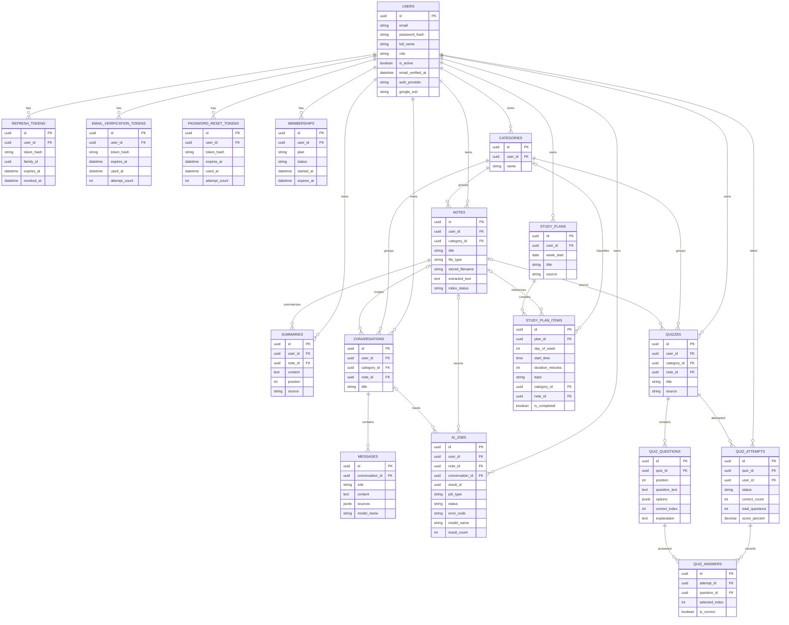

# Veritabanı şeması

## ER diyagramı

İlişkiler SQLAlchemy modelleri ve Alembic migration'larından çıkarılmıştır. Opsiyonel FK'ler diyagramda `o|` ile gösterilir. `ai_jobs.result_id` UUID alanıdır ancak şu an FK değildir.



## Tablolar

| Tablo | Amaç ve önemli alanlar |
|---|---|
| `users` | Hesap, rol (`user`/`admin`), etkinlik, e-posta doğrulaması ve giriş sağlayıcısı. Etkin e-posta adresi küçük/büyük harf duyarsız unique index ile korunur. |
| `refresh_tokens` | Refresh token hash'i, aile kimliği, sona erme ve iptal zamanları. Ham token saklanmaz. |
| `email_verification_tokens`, `password_reset_tokens` | Tek kullanımlık kodların hash'i, süresi, kullanımı ve en fazla beş deneme sayısı. |
| `memberships` | `free`/`plus` üyelik ve `active`/`canceled`/`expired` durumu. Kullanıcı başına aynı anda en fazla bir aktif üyelik. |
| `categories` | Kullanıcının kategorileri; kullanıcı başına kategori adı harf duyarsız unique. Notu olan kategori silinemez. |
| `notes` | Yüklenen PDF/TXT dosyasının metadata'sı ve çıkarılmış metni. `index_status`: `pending`, `indexed` veya `failed`. |
| `summaries` | Kullanıcıya ve nota ait kartlar; `source`: `ai` veya `manual`, ayrıca sıra (`position`). |
| `conversations`, `messages` | Kategoriye bağlı sohbet ve `user`/`assistant` mesajları; mesaj kaynakları JSONB liste olarak saklanır. |
| `ai_jobs` | `index_note`, `summarize_note`, `chat_message`, `generate_quiz` işleri; durum, hata, model ve sonuç metadata'sı. |
| `quizzes`, `quiz_questions` | Kategori/opsiyonel not bağlantılı quiz, sıralı sorular, seçenekler, doğru seçenek indeksi ve açıklama. |
| `quiz_attempts`, `quiz_answers` | Kullanıcı denemesi, durum/skor ve soru başına seçilen yanıt. Deneme-soru çifti başına en fazla bir yanıt. |
| `study_plans`, `study_plan_items` | Pazartesi başlayan haftalık planlar ve gün/saat/konu bazlı bloklar. Kullanıcı başına hafta başlangıcı unique. |

## Silme davranışları ve kısıtlar

- Kullanıcı silindiğinde ona ait çoğu kayıt FK `ON DELETE CASCADE` ile temizlenir.
- Kategorinin notlarla ilişkisi `RESTRICT` olduğundan önce notlar kaldırılmalıdır.
- Not silinince özetler silinir; quiz, sohbet, AI işi ve plan öğesi gibi kaynak bağlantıları modelde tanımlandığı şekilde `SET NULL` veya `CASCADE` olur.
- Sohbet silinince mesajları silinir; quiz silinince soruları ve denemeleri silinir; plan silinince plan öğeleri silinir.
- Aktif bir not için aynı türden birden fazla `pending`/`running` AI işi, kısmi unique index ile engellenir. Sohbet başına da aynı anda tek aktif `chat_message` işi olabilir.
- Quiz seçenekleri ve mesaj `sources` alanı PostgreSQL'de JSONB'dir. UUID alanları PostgreSQL UUID olarak saklanır.

## Migration kullanımı

Model değişiklikleri doğrudan canlı veritabanına uygulanmamalıdır; Alembic migration oluşturup gözden geçirin ve uygulayın:

```sh
alembic current
alembic history
alembic upgrade head
```

Docker imajının başlangıç komutu `alembic upgrade head` çalıştırır. Uygulama başlangıcında `Base.metadata.create_all()` kullanılmaz.
